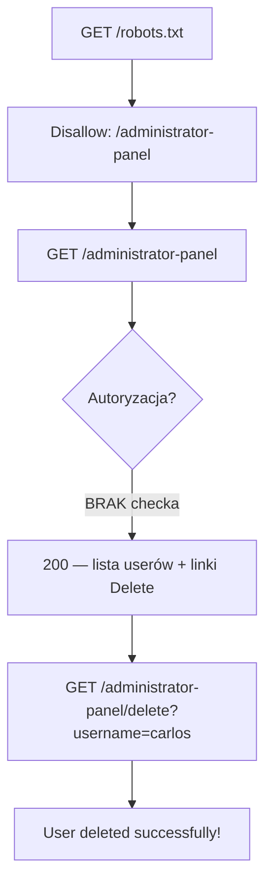

# Lab 01 — Unprotected admin functionality

| | |
|---|---|
| **Poziom** | Apprentice |
| **Status** | ✅ rozwiązany |
| **Data** | 2026-09-18 |
| **Narzędzia** | Burp (Repeater) + przeglądarka |

> 📖 **Teoria tej klasy podatności: [README tematu](README.md).** Tu tylko ten konkretny lab.

---

## Cel

Panel admina **bez żadnej ochrony**. Znaleźć go i usunąć użytkownika `carlos`.

---

## Trik tego labu

Panel nie ma linku w UI, a jego nazwa jest **losowa** przy każdej instancji. Ale ścieżka wisi w `robots.txt`:

```
GET /robots.txt
→ User-agent: *
  Disallow: /administrator-panel
```

`robots.txt` to prośba do botów wyszukiwarek („nie indeksuj"). Dla atakującego to **spis wrażliwych ścieżek, które właściciel sam chciał ukryć** — nie mechanizm bezpieczeństwa, tylko ogłoszenie ich istnienia (security through obscurity). Endpoint `/administrator-panel` nie sprawdza żadnych uprawnień → wchodzisz wprost.

---

## Przebieg



1. `GET /robots.txt` → wyczytaj ścieżkę panelu.
2. `GET /administrator-panel` → panel otwiera się bez logowania (200, lista userów + Delete).
3. Delete przy `carlos` (to `<a href>` = **GET** na `.../delete?username=carlos`).
4. „User deleted successfully!" → **Solved**.

---

## 💥 Moje potknięcia

- Brak realnych wpadek (lab trywialny), ale zapamiętane: `robots.txt` łatwo pomylić — „ukryte" ≠ „zabezpieczone".

---

## Czego ten lab dokłada

Najprostszy wariant: **zero checka**, atak = sama enumeracja ścieżki. Dwa złote niuanse na całą kategorię:
- **Enumeracja > zgadywanie** — `robots.txt` / `sitemap.xml` jako pierwszy ruch na targecie.
- **Strona ≠ akcja** — kasowanie poszło GET-em na osobny endpoint; każdy wrażliwy endpoint musi mieć własny check (wraca przy method-based i IDOR). Baza pod [[02-unprotected-admin-unpredictable-url]] (inny kanał wycieku ścieżki).
