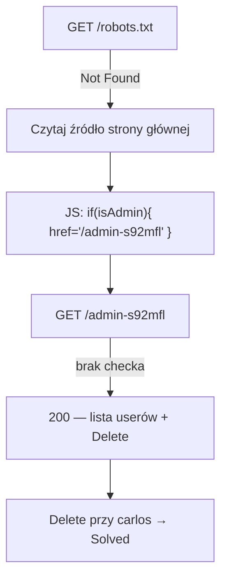

# Lab 02 — Unprotected admin functionality with unpredictable URL

| | |
|---|---|
| **Poziom** | Apprentice |
| **Status** | ✅ rozwiązany (samodzielnie) |
| **Data** | 2026-09-18 |
| **Narzędzia** | Burp (Proxy → HTTP history) + przeglądarka (View Source) |

> 📖 **Teoria tej klasy podatności: [README tematu](README.md).** Tu tylko ten konkretny lab.

---

## Cel

Panel admina **bez ochrony**, ale pod **nieprzewidywalnym URL-em**. Adres wycieka gdzieś w aplikacji — znaleźć go i usunąć `carlos`.

---

## Trik tego labu

`robots.txt` zwraca tu `"Not Found"` (dev „się nauczył" z [[01-unprotected-admin-functionality]]). Ale ścieżka panelu wycieka w **JavaScripcie strony głównej**:

```javascript
var isAdmin = false;
if (isAdmin) {
    var adminPanelTag = document.createElement('a');
    adminPanelTag.setAttribute('href', '/admin-s92mfl');  // ← tu wyciekło
    ...
}
```

Zamysł: „link do panelu pokażę tylko adminom" → owinięty w `if (isAdmin)`. Dla zwykłego usera `isAdmin=false`, link nie renderuje się w DOM. **Ale serwer wysyła cały kod JS do KAŻDEGO** — zahardkodowany string `'/admin-s92mfl'` jest w odpowiedzi, niezależnie od tego, czy `if` się wykonał. Czytasz źródło, bierzesz ścieżkę, a endpoint i tak nie ma checka (jak w labie 01).

To dwa błędy naraz: **information disclosure** (ścieżka w JS) + **broken access control** (brak checka na endpoincie).

---

## Przebieg



1. `GET /robots.txt` → `"Not Found"` (ślepy zaułek).
2. View Source strony głównej (albo response w Burp HTTP history).
3. W `<script>` znajdź `href` panelu: `/admin-s92mfl`.
4. `GET /admin-s92mfl` → panel bez logowania → Delete `carlos` → **Solved**.

---

## 💥 Moje potknięcia

- Brak wpadek, ale utrwalone: „nie ma linku na stronie" ≠ „nie ma endpointu". Kod w `if(false)` i tak jest wysłany do klienta — martwy kod też wycieka dane.

---

## Czego ten lab dokłada

Ten sam rdzeń co [[01-unprotected-admin-functionality]] (panel bez checka), ale **inny kanał wycieku ścieżki**: zamiast `robots.txt` — **client-side logic**. Główna lekcja: **kontrola dostępu po stronie klienta to kosmetyka**. Wszystko, co serwer wysłał do przeglądarki (nawet kod, który się „nie wykonał"), widzi atakujący. Motyw „nie ufaj klientowi" wróci w [[03-user-role-controlled-by-request-parameter]] (cookie) i [[05-user-id-password-disclosure]] (maskowanie hasła).
