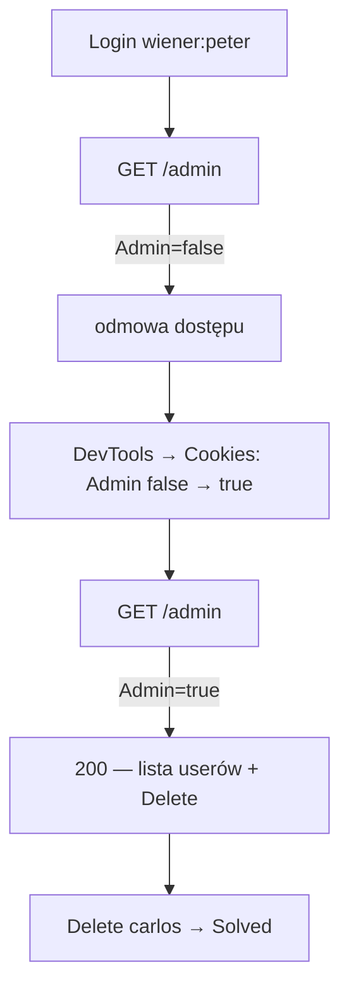

# Lab 03 — User role controlled by request parameter

| | |
|---|---|
| **Poziom** | Apprentice |
| **Status** | ✅ rozwiązany (samodzielnie) |
| **Data** | 2026-09-18 |
| **Narzędzia** | Chrome DevTools (Application → Cookies); wystarczyłby Burp |

> 📖 **Teoria tej klasy podatności: [README tematu](README.md).** Tu tylko ten konkretny lab.

---

## Cel

Panel `/admin` **identyfikuje adminów po sfałszowalnym cookie**. Zalogować się jako `wiener:peter`, podnieść uprawnienia i usunąć `carlos`.

---

## Trik tego labu

Tu bramka *istnieje* (`/admin` bez uprawnień → „Admin interface only available if logged in as an administrator"). Problem: **na czym opiera decyzję**. Po zalogowaniu w DevTools są **dwa** cookie:

| Cookie | Wartość | Charakter | Sfałszowalne? |
|---|---|---|---|
| `session` | `xdvwhd1KCkl...` | losowy token | ❌ nie — serwer trzyma mapowanie token→user u siebie |
| `Admin` | `false` | **goła flaga tekstowa** | ✅ tak — trywialnie |

Serwer czyta `Admin` i na tej podstawie wpuszcza do `/admin`. Zmieniasz `Admin: false` → `true` w DevTools i odświeżasz.

> ⭐ **Autentykacja tokenu ≠ autoryzacja roli.** `session` odpowiada „kim jesteś" (bezpieczny — nieodgadywalny wskaźnik do rekordu po stronie serwera). `Admin` miał odpowiadać „co ci wolno", ale zrobiony jako **jawny stan po stronie klienta** → fikcja bezpieczeństwa.

To **vertical privilege escalation** (user → admin) przez **parameter-based access control**.

---

## Przebieg

1. Login `wiener:peter`.
2. `/admin` → odmowa.
3. DevTools → Application → Cookies → `Admin` z `false` na `true`.
4. Odśwież `/admin` → panel → Delete `carlos` → **Solved**.

---

## 💥 Moje potknięcia

- Brak wpadek. Zapamiętane rozpoznanie w praktyce: po zalogowaniu **przejrzyj wszystkie cookie / hidden fields / parametry** — szukaj czegoś, co pachnie rolą/flagą (`Admin`, `role`, `isAdmin`, `type=user`). Wartości do próbowania: `true`/`false`, `1`/`0`, `admin`/`user`.

---

## Czego ten lab dokłada

Pierwszy lab z **wadliwym** (nie brakującym) checkiem. Nowy koncept: rola trzymana w danych od klienta (cookie/hidden field/`?admin=true`) jest z definicji do obejścia. Rozróżnienie **token sesji** (losowy, nietykalny) vs **jawna flaga** (edytowalna) — atakujesz to drugie. Następny lab [[04-user-id-unpredictable-guid]] przechodzi z vertical na **horizontal** (IDOR na `id`).
