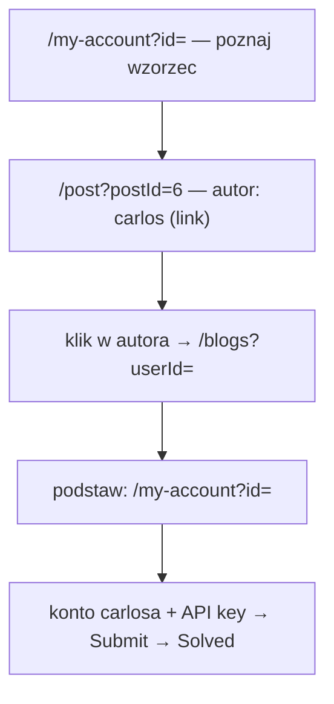

# Lab 04 — User ID controlled by request parameter, with unpredictable GUIDs

| | |
|---|---|
| **Poziom** | Apprentice |
| **Status** | ✅ rozwiązany (samodzielnie) |
| **Data** | 2026-09-18 |
| **Narzędzia** | przeglądarka (klikanie + pasek adresu); wystarczyłby Burp |

> 📖 **Teoria tej klasy podatności: [README tematu](README.md).** Tu tylko ten konkretny lab.

---

## Cel

Horizontal privilege escalation na stronie konta, ale userzy identyfikowani przez **GUID-y** (losowe). Znaleźć GUID `carlos`, wejść na jego konto i przesłać jego API key.

---

## Trik tego labu

Endpoint `/my-account?id=<GUID>` ślepo ufa `id` → **IDOR**. GUID (`b456ab20-...`) jest nieodgadywalny, więc deweloper myśli „IDOR niewykorzystywalny". Błąd: podatność nadal istnieje, GUID tylko utrudnia **znalezienie** wartości.

A GUID carlosa **wycieka w innym module**: jego wpis na blogu ma autora-link prowadzący do `/blogs?userId=<GUID carlosa>`. Bierzesz ten GUID i podstawiasz w `?id=`.

> ⭐ Nieodgadywalny identyfikator (GUID) to **NIE kontrola dostępu** — znowu security through obscurity (jak losowa nazwa panelu w [[02-unprotected-admin-unpredictable-url]]). Prawdziwa ochrona = authz per-obiekt.

To **chaining**: wyciek id (information disclosure) + IDOR.

---

## Przebieg

1. Login `wiener:peter`; `/my-account?id=<swój GUID>` — poznaj wzorzec.
2. Wejdź na wpis blogowy carlosa, kliknij autora → `/blogs?userId=<GUID carlosa>` (GUID w pasku adresu).
3. Podstaw: `/my-account?id=<GUID carlosa>` → konto carlosa + API key.
4. Prześlij API key → **Solved**.

---

## 💥 Moje potknięcia

- Brak wpadek, ale kluczowe rozpoznanie: IDOR z GUID-em wygląda na „niewykorzystywalny" — **nie odpuszczaj, poszukaj gdzie aplikacja sama ujawnia cudze id** (autorzy postów, komentarze, recenzje, odpowiedzi API). Wektor wycieku bywa w **zupełnie innym module** niż podatny endpoint (tu: blog ujawnia GUID, dziura jest na `/my-account`). Myśl **całą aplikacją**.

---

## Czego ten lab dokłada

Pierwszy **horizontal** (dostęp do zasobu innego usera, nie eskalacja w górę). Nowe koncepty: **IDOR/BOLA** i **chaining** (złożenie wycieku id + IDOR w realny atak). Pokazuje, że losowość identyfikatora to obscurity, nie authz. Następny [[05-user-id-password-disclosure]] łączy IDOR z password disclosure i zamienia horizontal w vertical.
