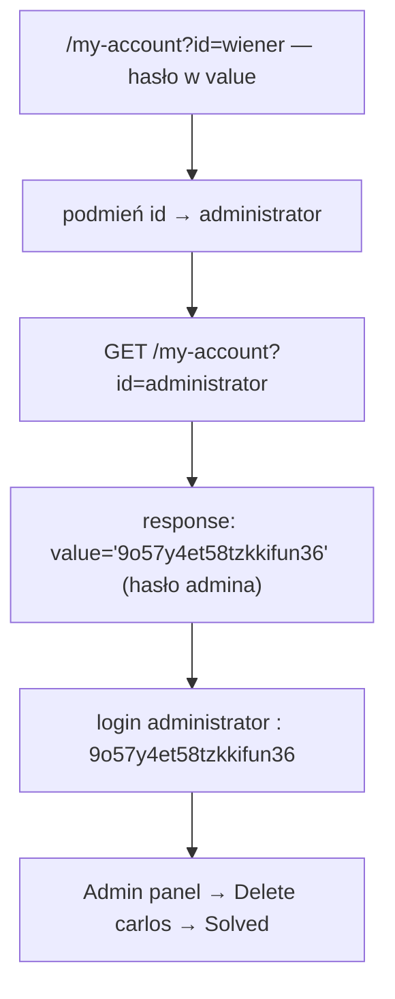

# Lab 05 — User ID controlled by request parameter with password disclosure

| | |
|---|---|
| **Poziom** | Apprentice |
| **Status** | ✅ rozwiązany (samodzielnie) |
| **Data** | 2026-09-18 |
| **Narzędzia** | Burp (Proxy → HTTP history, podgląd response) + przeglądarka |

> 📖 **Teoria tej klasy podatności: [README tematu](README.md).** Tu tylko ten konkretny lab.

---

## Cel

Strona konta zawiera **hasło zalogowanego usera** prefillowane w zamaskowanym polu. Zdobyć hasło **administratora**, zalogować się jako on i usunąć `carlos`.

---

## Trik tego labu

Na `GET /my-account?id=administrator` (IDOR — ślepe zaufanie `id`) serwer zwraca w HTML:

```html
<input required type=password name=password value='9o57y4et58tzkkifun36'/>
```

- Na ekranie: `••••••••••` — bo `type="password"` każe przeglądarce zamaskować.
- W źródle: **hasło otwartym tekstem** w `value`, wysłane przez serwer.

> ⭐ **Maskowanie hasła to renderowanie w przeglądarce, nie ukrycie danych.** Wartość leci w odpowiedzi HTTP — czytasz ją w View Source / Burp.

To **chaining trzech błędów**:

| Krok | Błąd | Efekt |
|---|---|---|
| `?id=administrator` | **IDOR** | horizontal: cudze konto |
| `value='...'` w HTML | **password disclosure** | sekret admina |
| login admin → Delete | **broken access control** na panelu | vertical: uprawnienia admina |

Czyli **horizontal → vertical escalation**: „innym userem" jest admin, więc przejęcie jego konta daje jego uprawnienia.

---

## Przebieg



1. Login `wiener:peter`, `/my-account?id=wiener` — zauważ hasło w `value`.
2. Podmień na `?id=administrator`, obejrzyj **response** (nie ekran) → odczytaj `value` = hasło admina.
3. Wyloguj, zaloguj jako `administrator` tym hasłem.
4. „Admin panel" → Delete `carlos` → **Solved**.

---

## 💥 Moje potknięcia

- Brak wpadek, ale utrwalone: nie patrz na wyrenderowaną stronę — **czytaj surowy response**. Gwiazdki w polu ≠ brak danych. W formularzu był też token `csrf` — osobny mechanizm, tu bez znaczenia (tylko czytasz), zapamiętane na później.

---

## Czego ten lab dokłada

Ostatni lab tematu — spina wszystko: **IDOR + disclosure + broken access control** w pełne przejęcie. Nowy koncept: **horizontal → vertical** (przejęcie uprzywilejowanego usera zamienia ruch „w bok" w „w górę"). Maskowanie `type=password` jako kolejny przykład client-side „ochrony", która nią nie jest (motyw z [[02-unprotected-admin-unpredictable-url]]).
