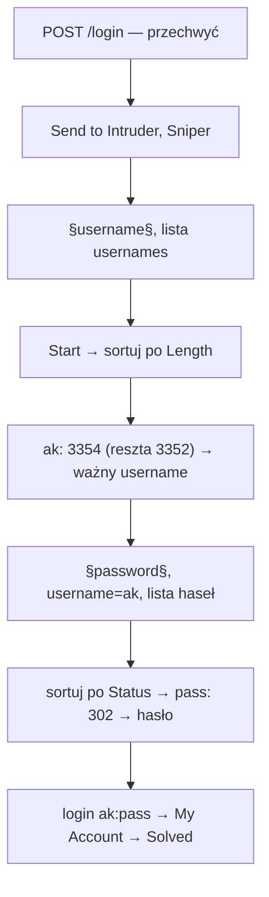

# Lab 01 — Username enumeration via different responses

| | |
|---|---|
| **Poziom** | Apprentice |
| **Status** | ✅ rozwiązany (samodzielnie) |
| **Data** | 2026-09-20 |
| **Narzędzia** | Burp Community (Proxy + **Intruder**, atak Sniper) |

> 📖 **Teoria tej klasy podatności: [README tematu](README.md).** Tu tylko ten konkretny lab.

---

## Cel

Aplikacja podatna na **username enumeration** i **password brute-force**. Wyliczyć ważny username → złamać jego hasło → wejść na konto (listy słów dane przez lab).

---

## Trik tego labu

Aplikacja jest **oraclem** — zdradza ważny login przez różnicę w **długości odpowiedzi**:
- zły username → `"Invalid username"` (17 znaków)
- dobry username, złe hasło → `"Incorrect password"` (18 znaków) → odpowiedź **o 2 bajty dłuższa**

Status był identyczny (200) w obu przypadkach — dlatego sygnał siedział w **Length**, nie w statusie.

**Dwa przebiegi Intrudera (Sniper):**
1. § na `username`, lista usernames → sortuj po **Length** → `ak` odstaje (3354 vs 3352) = ważny login.
2. § na `password`, `username=ak` na stałe, lista haseł → sortuj po **Status** → `pass` daje **302** = udany login.

---

## Przebieg

1. Przechwyć `POST /login` → **Send to Intruder** (Sniper).
2. § na `username`, payload = lista usernames → Start → sortuj po **Length** → `ak` (3354).
3. Potwierdź ręcznie: login `ak` + byle hasło → `"Incorrect password"` (nie „Invalid username").
4. Nowy atak: § na `password`, `username=ak` na stałe, payload = lista haseł → szukaj **302** → `pass`.
5. Login `ak:pass` → **Solved**.

---

## 💥 Moje potknięcia

- **Nie patrzyłem na Length, tylko na status.** Enumeracja siedziała w **2 bajtach różnicy** w kolumnie Length, przy identycznym statusie 200. Lekcja: **zawsze sortuj po Length ORAZ Status** — Length odpowiedzi zależy od treści, nawet jedna kropka/spacja robi różnicę i bywa jedynym sygnałem.
- Przy brute-force hasła trzeba pamiętać, żeby **na stałe wpisać znaleziony username** (§ tylko na password).

---

## Czego ten lab dokłada

Pierwszy lab tematu — wprowadza **oracle** i jego matematykę (mnożenie → dodawanie) oraz warsztat **Burp Intruder Sniper**. Kluczowy nawyk: **szukaj odstającego wiersza** (po Status + Length) — ta sama mechanika wróci przy [[02-basic-ssrf-another-backend]] (skan sieci). `302 = sukces logowania`.
