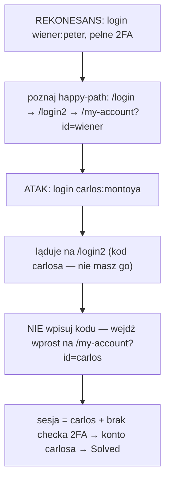

# Lab 02 — 2FA simple bypass

| | |
|---|---|
| **Poziom** | Apprentice |
| **Status** | ✅ rozwiązany (samodzielnie) |
| **Data** | 2026-09-20 |
| **Narzędzia** | przeglądarka (+ Email client labu); Burp opcjonalnie |

> 📖 **Teoria tej klasy podatności: [README tematu](README.md).** Tu tylko ten konkretny lab.

---

## Cel

2FA da się obejść. Masz login+hasło ofiary (`carlos:montoya`), ale **nie masz jej kodu 2FA**. Wejść na konto carlosa.

---

## Trik tego labu

Przepływ 2FA jest rozbity na dwa kroki, a serwer nadaje stan „zalogowany" **za wcześnie**:
1. `POST /login` (login+hasło) → serwer **już wystawia sesję zalogowanego usera** → redirect na `/login2` (ekran kodu).
2. `POST /login2` (kod) → tylko „potwierdza".

> ⭐ Po kroku 1 cookie `session` **już należy do carlosa** — zanim wpiszesz jakikolwiek kod. `/my-account` sprawdza tylko „czy masz ważną sesję?", nie „czy przeszedłeś krok 2?". Drugi czynnik istnieje, ale **nie jest egzekwowany** → wchodzisz wprost na stronę konta, pomijając ekran kodu.

To **broken access control w przepływie 2FA**.

---

## Przebieg

1. **Rekonesans** na własnym `wiener:peter`: przejdź pełne 2FA (kod z Email client), zobacz że strona konta = `/my-account?id=wiener`, kroki to `/login` → `/login2` → `/my-account`.
2. **Atak:** login `carlos:montoya` → lądujesz na `/login2`.
3. **Przeskok:** zamiast kodu wpisz w pasku `/my-account?id=carlos`.
4. Serwer widzi ważną sesję carlosa, nie sprawdza 2FA → wpuszcza → **Solved**.

---

## 💥 Moje potknięcia

- Brak wpadek, ale kluczowa metodyka: **rekon najpierw** na koncie, które kontrolujesz (jaki URL ma strona konta, jak nazywają się kroki) — bez tego nie wiesz, na co „przeskoczyć". I nie zakładaj, że skoro widzisz ekran kodu, serwer go wymaga — **sprawdź**, wchodząc bezpośrednio na chronioną stronę.

---

## Czego ten lab dokłada

Drugi wektor tematu (po enumeracji): **niewyegzekwowana bramka**. Nowy koncept: **pending vs authenticated session** — stan „zalogowany" nadany za wcześnie. Metodyka wieloetapowa: **rekon happy-path na własnym koncie → powtórz z pominięciem bramki na koncie ofiary**. To ten sam motyw „obecność ekranu ≠ egzekwowanie" co w access control (strona ≠ akcja).
