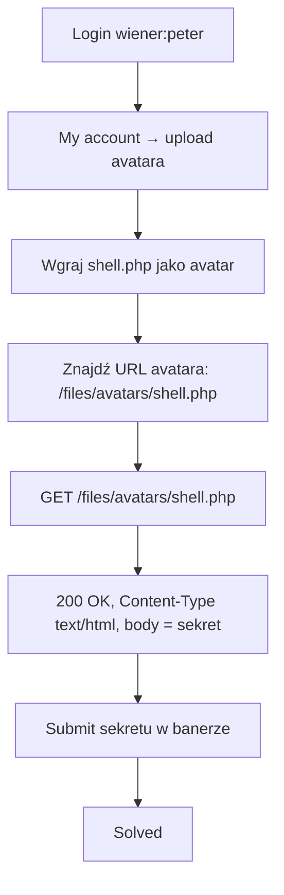

# Lab 01 — Remote code execution via web shell upload

- **Kategoria:** File upload vulnerabilities → unrestricted upload / web shell
- **Poziom:** Apprentice
- **Data:** 2026-10-16
- **Status:** ✅ rozwiązany
- **Narzędzia:** Burp Suite (Proxy + Repeater), plik `exploits/shell.php`
- **Ścieżka:** początek tematu **File upload** (9 labek), po SSRF

---

## Cel labu

Upload avatara **nie waliduje niczego**. Trzeba wgrać **web shell w PHP**, wykonać go i wyciągnąć zawartość pliku `/home/carlos/secret`, a sekret wrzucić w panelu.

---

## Koncept: upload + wykonywalność = RCE

File upload vuln = serwer przyjmuje plik i zapisuje go na filesystemie **bez wystarczającej walidacji** (nazwa, typ, zawartość, rozmiar). Najgorszy wariant:

> Serwer pozwala wgrać **plik ze skryptem server-side** (PHP/JSP/…) **i jest skonfigurowany, żeby go wykonać** przy żądaniu HTTP → z „uploadu obrazka" robi się **RCE (Remote Code Execution)**.

**Web shell** = złośliwy skrypt dający wykonywanie kodu/komend na serwerze przez zwykłe HTTP. Udany web shell = faktycznie pełna kontrola nad serwerem (read/write plików, eksfiltracja, pivot w sieć).

### Dlaczego PHP się wykonuje (sedno mechanizmu)

Sam plik nic nie robi — o wykonaniu decyduje **konfiguracja serwera WWW**:

| Prosisz o… | Serwer robi… | Dostajesz… |
|---|---|---|
| `avatar.png` | oddaje bajty pliku | statyczny obrazek |
| `shell.php` | **uruchamia interpreter PHP** na pliku | **wynik wykonania kodu** |

PHP to dziedzictwo modelu CGI: „jeden plik = jeden endpoint, interpretowany na żądanie". Apache/Nginx typowo mają regułę „każdy `.php` w katalogu webowym → przepuść przez PHP". Dlatego PHP jest modelową ofiarą tych labek — nie bo „hakerski", tylko bo **domyślnie wykonywalny per-plik**.

> **To samo dałoby się w Ruby/Perl/ASP — gdyby serwer był tak skonfigurowany (CGI, mod_ruby).** Rails standardowo NIE działa w modelu „plik=strona" (`public/` serwuje statycznie, routing idzie przez `routes.rb`), więc wrzucony `.rb` leży jak martwy tekst. Podatność siedzi w **relacji upload + konfiguracja wykonywania plików**, nie w języku.

---

## Mechanizm tego labu: zero walidacji

Lab to najprostszy wariant (*„doesn't perform any validation"*) — odpowiednik gołego `../` w path traversal albo braku checka w access control 01. Nie trzeba niczego obchodzić.

Web shell (plik `exploits/shell.php`):

```php
<?php echo file_get_contents('/home/carlos/secret'); ?>
```

- `echo` = „wypisz do ciała odpowiedzi HTTP" (jak `puts`/`print` w Ruby).
- `file_get_contents('/home/carlos/secret')` = „wczytaj cały plik do stringa" (jak `File.read`).
- Kod żyje **tylko wewnątrz `<?php ... ?>`**; reszta pliku `.php` leciałaby do odpowiedzi dosłownie (model jak `.erb` w Railsach).

---

## Kroki / przepływ ataku



1. Zaloguj `wiener:peter`, włącz Burp Proxy.
2. **My account** → upload → wybierz `shell.php` (lab przyjmuje `.php` bez marudzenia).
3. Znajdź, gdzie serwowany jest avatar — w źródle strony `` albo w Proxy history. Tu: **`/files/avatars/shell.php`**.
4. W Repeaterze: `GET /files/avatars/shell.php`.
   - Odpowiedź: **200 OK, `Content-Type: text/html`, Content-Length: 32**, body = `IxbBrH8VPrsF7sRiHfc9uboUyNBxizXe`.
5. Wklej sekret w **Submit solution** → **Solved**.

---

## ⭐ Dowód, że kod się wykonał

W odpowiedzi `Content-Length: 32` = długość **sekretu**, nie kodu źródłowego (`<?php echo file_get_contents(...)?>` ma ~44 znaki). Gdyby serwer oddał plik jako statyczny, zobaczyłbyś treść PHP. Zobaczyłeś **wynik** → interpreter zadziałał. `Server: Apache/2.4.41 (Ubuntu)` potwierdza setup pod PHP.

---

## Pułapki

- **Ścieżka absolutna vs względna** — `/home/carlos/secret` (ze slashem = od korzenia FS) zadziała zawsze; `home/carlos/secret` (bez slasha) PHP szukałby względem katalogu skryptu (`/files/avatars/...`) → pustka. (Ta sama logika co path traversal.) Realnie potknąłem się na braku wiodącego `/`.
- **Katalog avatara trzeba odkryć, nie zgadnąć** — podejrzyj faktyczny `src`/Proxy history (tu `/files/avatars/`, ale bywa inaczej).
- **Kopiuj cały sekret dokładnie** — bez spacji/entera na końcu.

---

## Pojęcia do zapamiętania

- **File upload vulnerability** — przyjęcie i zapis pliku bez wystarczającej walidacji (nazwa/typ/zawartość/rozmiar).
- **Web shell** — skrypt na serwerze dający wykonywanie kodu/komend przez HTTP; udany = pełna kontrola.
- **RCE (Remote Code Execution)** — zdalne wykonanie kodu na serwerze; najgroźniejszy skutek uploadu.
- **Server-side script execution** — serwer wykonuje `.php`/`.jsp`/… zamiast serwować je jako statyczny plik; o tym decyduje konfiguracja, nie plik.
- `<?php ... ?>` — znaczniki PHP; kod tylko wewnątrz, reszta pliku = dosłowny output (model jak `.erb`).

---

## Mindset

Sygnał „to może być file upload → RCE": jest **upload pliku** (avatar, załącznik) + podejrzenie, że serwer **wykonuje** pewne rozszerzenia. Schemat ataku: **wgraj plik ze skryptem → znajdź URL, pod którym jest serwowany → poproś o niego → serwer wykonuje kod → czytasz wynik w odpowiedzi**.

Ten lab był goły (zero walidacji). Kolejne labki File upload będą **dokładać walidację do obejścia**: Content-Type manipulowany w Burpie, blacklisty rozszerzeń (`.php5`, `.phtml`), obejścia przez `Content-Type: image/png`, konfiguracja per-katalog (`.htaccess`), polygloty (PHP w metadanych obrazka), null byte, path traversal w nazwie pliku. Rdzeń zawsze ten sam: **dostarcz wykonywalny plik tam, gdzie serwer go odpali.**
