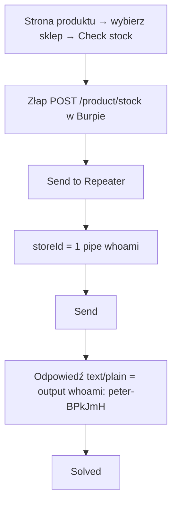

# Lab 01 — OS command injection, simple case

- **Kategoria:** OS command injection (część „Server-side vulnerabilities")
- **Poziom:** Apprentice
- **Data:** 2026-11-23
- **Status:** ✅ rozwiązany
- **Narzędzia:** Burp Suite (Proxy + Repeater)
- **Ścieżka:** początek tematu **OS command injection**, po File upload

---

## Cel labu

Stock checker buduje polecenie powłoki z `productId` i `storeId` od użytkownika i **oddaje surowy output w odpowiedzi**. Trzeba wykonać `whoami` i zobaczyć nazwę bieżącego usera.

---

## Koncept: user input ląduje w stringu polecenia powłoki

OS command injection (= shell injection): aplikacja buduje **string polecenia systemowego** i wkleja do niego input użytkownika, po czym uruchamia go przez powłokę (`/bin/sh -c "..."`). Jeśli input zawiera **metaznaki powłoki**, przestaje być „argumentem", a staje się **nowym poleceniem**. Skutek: wykonanie dowolnego kodu na serwerze (pełna kompromitacja, pivot w sieć).

### Po railsowemu

Dokładnie to, przed czym ostrzega Rails przy interpolacji do shella:

```ruby
system("stockreport.pl #{product_id} #{store_id}")   # ← podatne
`ping #{host}`                                         # ← to samo
# bezpiecznie: system("stockreport.pl", product_id, store_id) — bez powłoki, argv
```

Gdy polecenie idzie **przez powłokę**, shell interpretuje: `;`  `&`  `|`  `` ` ``  `$(...)`  `\n`.

### Metaznaki-separatory

| Znak | Działanie |
|---|---|
| `;` | wykonaj kolejne polecenie (Linux) |
| `&` | wykonaj w tle / rozdziel polecenia |
| `|` | pipe: stdout lewego → stdin prawego |
| `` `cmd` `` / `$(cmd)` | podstawienie wyniku polecenia |
| `\n` | nowa linia = nowe polecenie |

> **Execute, nie read** (jak path traversal) — najgroźniejszy prymityw server-side.

---

## Mechanizm tego labu

Żądanie: `POST /product/stock`, ciało `application/x-www-form-urlencoded`:
```
productId=1&storeId=1
```
Na serwerze ~ `stockreport.pl <productId> <storeId>`, output wraca w odpowiedzi (`Content-Type: text/plain`). Zero obrony → wstrzykujemy do `storeId`.

**Payload (w wartości `storeId`):**
```
productId=1&storeId=1|whoami
```
Polecenie: `stockreport.pl 1 1 | whoami`. Pipe kieruje wyjście `stockreport.pl` na wejście `whoami`; `whoami` olewa stdin i wypisuje usera → **`peter-BPkJmH`** w odpowiedzi (`Content-Length: 13`, zamiast liczby stanu magazynowego).

---

## ⭐ Pułapka, na której się potknąłem: separator shella vs składnia transportu

Pierwsza próba (wg przykładu z teorii) **nie zadziałała**:
```
productId=1 & whoami &storeId=1        # odpowiedź: 62 (normalny stan), injection pominięty
```

Dlaczego: `&` ma **dwa znaczenia**, a parser formularza czyta ciało **pierwszy**, zanim cokolwiek trafi do shella:

| `&` dla… | znaczenie |
|---|---|
| parsera `x-www-form-urlencoded` | separator **parametrów** |
| powłoki | separator **poleceń** |

Serwer rozbił string na trzy pola formularza (widać w Burp **Inspector → Request body parameters**: `productId`, osobny `whoami`, `storeId`). `whoami` stał się ignorowanym parametrem, do shella nigdy nie poszedł.

**Zasada:** payload musi najpierw przetrwać **warstwę transportu** (tu: form-urlencoding), a dopiero potem interpretuje go shell. Dwa wyjścia:
1. **Użyj `|`** — nie jest metaznakiem formularza, przechodzi w całości jako wartość parametru. (Wybrane — najczystsze, zero kodowania.)
2. **Zostań przy `&`, ale URL-zakoduj** separatory shella (zaznacz w Repeaterze → **Ctrl+U** → `%26`), żeby parser formularza ich nie zjadł i zostały w wartości parametru.

---

## Kroki / przepływ ataku



1. Wejdź na produkt, wybierz sklep (np. London), **Check stock** — złap żądanie.
2. **Send to Repeater**.
3. Zmień ciało na `productId=1&storeId=1|whoami` (pipe wewnątrz wartości `storeId`).
4. **Send** → body = `peter-BPkJmH`. Lab solved (sam fakt wykonania whoami rozwiązuje labkę).

---

## Pojęcia do zapamiętania

- **OS command injection / shell injection** — user input trafia do stringu polecenia uruchamianego przez powłokę; metaznaki → wykonanie dowolnych poleceń.
- **Shell metacharacters** — `; & | \n $() `` ``; separatory i podstawienia interpretowane przez powłokę.
- **In-band / returned injection** — output komendy wraca wprost w odpowiedzi HTTP (tu tak). Przeciwieństwo: blind (brak outputu — trzeba exfiltrować inaczej).
- **Warstwa transportu vs shell** — payload przechodzi przez parser protokołu (form-urlencoded, JSON, URL) ZANIM dotrze do powłoki; kolizja znaczeń znaku (`&`) psuje atak.
- **Argv vs shell** — przekazanie argumentów jako tablicy (`system("cmd", a, b)`) omija powłokę i jest odporne na injection; interpolacja do jednego stringa — nie.

---

## Mindset

Sygnał „to może być command injection": aplikacja robi coś, co pachnie **wywołaniem narzędzia systemowego** (ping, konwersja pliku, raport, legacy skrypt) z twoim inputem w argumentach. Test: wstrzyknij separator + komendę-sondę. `whoami` albo `echo <losowy string>` (echo potwierdza wykonanie, bo twój string wraca w outpucie).

Rdzeń, który się powtórzy w kolejnych labkach tego tematu: **znajdź parametr lądujący w poleceniu → wstrzyknij separator shella → upewnij się, że payload przeżył warstwę transportu**. Dalej temat dokłada trudności: brak outputu (**blind** — detekcja po czasie `; sleep 10`, przez wyjście out-of-band / DNS, albo przekierowanie outputu do pliku w web rootcie), oraz filtrowanie znaków (obejścia). Szersza zasada: nigdy nie buduj polecenia powłoki przez konkatenację danych od użytkownika.
