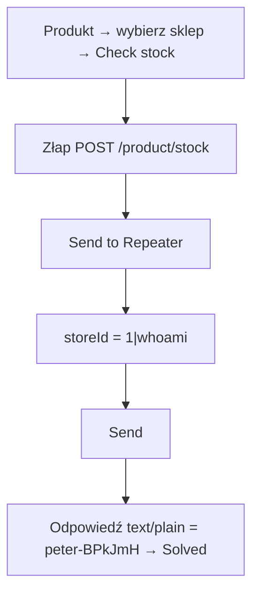

# Lab 01 — OS command injection, simple case

| | |
|---|---|
| **Poziom** | Apprentice |
| **Status** | ✅ rozwiązany |
| **Data** | 2026-11-23 |
| **Narzędzia** | Burp (Proxy + Repeater) |

> 📖 **Teoria tej klasy podatności: [README tematu](README.md).** Tu tylko ten konkretny lab.

---

## Cel

Stock checker buduje polecenie powłoki z `productId` i `storeId` i oddaje **surowy output** w odpowiedzi. Wykonać `whoami` i zobaczyć nazwę usera.

---

## Trik tego labu

Żądanie `POST /product/stock`, ciało `application/x-www-form-urlencoded`: `productId=1&storeId=1`. Na serwerze ~ `stockreport.pl <pid> <sid>`, zero obrony. Wstrzykujesz pipe w `storeId`:

```
productId=1&storeId=1|whoami
```

Polecenie: `stockreport.pl 1 1 | whoami`. Pipe kieruje wyjście `stockreport.pl` na wejście `whoami`; `whoami` olewa stdin i wypisuje usera → **`peter-BPkJmH`** w odpowiedzi (`Content-Length: 13`, zamiast liczby stanu magazynowego).

---

## Przebieg



1. Na produkcie wybierz sklep, **Check stock** — złap żądanie.
2. **Send to Repeater**.
3. Ciało: `productId=1&storeId=1|whoami`.
4. **Send** → body = `peter-BPkJmH`. **Solved**.

---

## 💥 Moje potknięcia

- **`& whoami &` NIE zadziałał** — wziąłem payload wprost z teorii PortSwiggera, ale `&` to też separator parametrów `x-www-form-urlencoded`. Parser formularza zjadł payload: w Burp Inspector `whoami` pokazał się jako **osobny parametr**, odpowiedź wróciła normalna (`62`, stan magazynowy). Dopiero `|` (nie koliduje z form-encoding) zadziałał — albo trzeba było URL-zakodować `&`→`%26` (Ctrl+U).
- **Lekcja:** payload musi przeżyć **warstwę transportu** (parser protokołu) ZANIM dotrze do shella. To przeniesie się na JSON, URL, nagłówki.

---

## Czego ten lab dokłada

Wprowadza rdzeń OS command injection (separator + sonda, output in-band) i **najważniejszą praktyczną pułapkę tematu: separator shella vs warstwa transportu**. Twój railsowy instynkt (`system("cmd #{x}")` vs `system("cmd", x)`) to dokładnie oś tej podatności. Dalej: blind (sleep, out-of-band) i obejścia filtrów.
