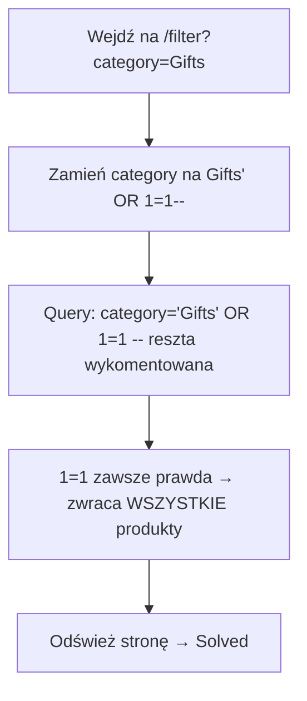

# Lab 01 — SQL injection in WHERE clause (retrieval of hidden data)

| | |
|---|---|
| **Poziom** | Apprentice |
| **Status** | ✅ rozwiązany |
| **Data** | 2026-11-24 |
| **Narzędzia** | przeglądarka (pasek adresu), Burp (podgląd) |

> 📖 **Teoria tej klasy podatności: [README tematu](README.md).** Tu tylko ten konkretny lab.

---

## Cel

Filtr kategorii buduje `SELECT ... WHERE category = '<input>' AND released = 1`. Trzeba wstrzyknąć SQL tak, żeby pokazać **nieopublikowane** produkty (`released = 0`).

---

## Trik tego labu

Punkt wejścia: `GET /filter?category=Gifts`. Wstrzykujesz w `category`.

**Payload, który zalicza:**
```
Gifts' OR 1=1--
```
Efektywne zapytanie:
```sql
SELECT * FROM products WHERE category = 'Gifts' OR 1=1-- ' AND released = 1
```
`1=1` jest zawsze prawdą → `WHERE` przepuszcza **wszystkie** wiersze (wszystkie kategorie, released i nie), a `--` odcina filtr `AND released = 1`. W efekcie na liście pojawiają się produkty normalnie ukryte.

(`%27` w URL = `'`, `%20` = spacja — przeglądarka koduje to automatycznie z paska adresu.)

---

## Przebieg



1. Wejdź na kategorię (np. Gifts).
2. W pasku adresu zmień `category=Gifts` na `category=Gifts' OR 1=1--`.
3. Enter → widać wszystkie produkty, w tym nieopublikowane.
4. **Odśwież** (grader aktualizuje baner przy normalnym załadowaniu) → **Solved**.

---

## 💥 Moje potknięcia

- **Grader patrzy na EFEKT, nie na intencję.** Najpierw próbowałem `Gifts' AND released=0--` — logicznie najprecyzyjniejszy („pokaż mi dokładnie ukryte") i realnie pokazał nieopublikowany produkt, ale **lab nie zaliczył**. Dopiero `OR 1=1--` (szeroki strzał, cały katalog) trafił w warunek gradera. Wniosek: do „udowodnij, że podatność istnieje" bierz **szeroki strzał** (`OR 1=1--`), a precyzyjne warunki (`AND released=0`) zostaw na *celowane* wyciąganie danych.
- **Baner się nie odświeżał** — `Gifts'--` (bez `OR 1=1`) też pokazał ukryty produkt, ale status „Not solved" wisiał, bo wszedłem w produkt zamiast odświeżyć listę. Grader aktualizuje się przy normalnym załadowaniu strony.

---

## Czego ten lab dokłada

Pierwszy kontakt z SQLi — pokazuje **rdzeń** (`'` + `--` + `OR 1=1`) w najprostszym kontekście: parametr w URL, wynik widoczny wprost na stronie. Baza dla wszystkiego, co dalej (login bypass → UNION → blind).
