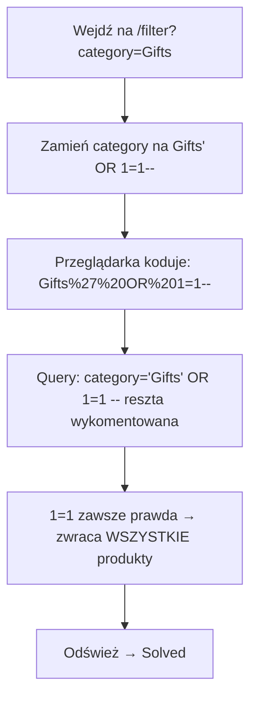

# Lab 01 — SQL injection in WHERE clause (retrieval of hidden data)

- **Kategoria:** SQL injection (część „Server-side vulnerabilities")
- **Poziom:** Apprentice
- **Data:** 2026-11-24
- **Status:** ✅ rozwiązany
- **Narzędzia:** przeglądarka (pasek adresu), Burp (podgląd)
- **Ścieżka:** początek tematu **SQL injection**, po OS command injection

---

## Cel labu

Filtr kategorii buduje `SELECT ... WHERE category = '<input>' AND released = 1`. Trzeba wstrzyknąć SQL tak, żeby pokazać **nieopublikowane** produkty (`released = 0`).

---

## Koncept: dane użytkownika sklejane w string zapytania

SQL injection = aplikacja buduje zapytanie SQL **konkatenując input użytkownika jako tekst**, zamiast przekazać go jako parametr. Twój input może wtedy **wyjść z kontekstu danych i stać się kodem SQL**.

### Model mentalny: szablon z dziurą

Aplikacja pisze cudzysłowy **za ciebie**:

```
SELECT * FROM products WHERE category = '???' AND released = 1
                                        ↑   ↑
                              apka pisze | | apka pisze
                                     twój input
```

Po railsowemu (to samo niebezpieczeństwo):
```ruby
where("category = '#{params[:category]}'")   # ❌ podatne
where(category: params[:category])           # ✅ parametryzowane (ciapek zostaje danymi)
```

### ⭐ Sedno: ciapek `'` to wytrych z danych do kodu

- **Bez `'`**: `category = 'Gifts OR 1=1'` → wszystko w cudzysłowie to **tekst** (dziwna nazwa kategorii). `OR 1=1` nic nie robi.
- **Z `'`**: `category = 'Gifts' OR 1=1` → zamykasz string **swoim** ciapkiem, wyskakujesz do **kodu**; `OR 1=1` to teraz warunek, który silnik **wykonuje**.

To jest esencja każdego injection: przeskoczyć z „jestem danymi" do „jestem kodem". (W OS command injection tym wytrychem był `|`/`&`.)

### Po co `--` na końcu

`--` = komentarz **do końca linii**. Szablon dokleja po twoim inpucie `' AND released = 1` — zostaje **osierocony ciapek** (apki), który bez obsługi wywaliłby składnię. `--` zakopuje całą tę resztę (osierocony `'` + `AND released = 1`), więc:
1. nie ma błędu składni,
2. znika filtr `AND released = 1`.

Niuans: w **MySQL** `--` wymaga spacji po sobie (`-- `) albo używa się `#`. Tu (PostgreSQL) samo `--` działa.

---

## Mechanizm tego labu + warianty (przetestowane)

Request: `GET /filter?category=Gifts`. Wstrzykujemy w `category`.

| Payload (w pasku adresu) | Efektywne query | Rezultat |
|---|---|---|
| `Gifts'--` | `category='Gifts'` | wszystkie Gifts, w tym ukryte (filtr `released` wycięty) |
| `Gifts' AND released=0--` | `category='Gifts' AND released=0` | **tylko** nieopublikowane Gifts (1 szt.) — **nie zaliczyło** |
| `Gifts' OR 1=1--` | `category='Gifts' OR 1=1` | **cały** katalog, wszystkie kategorie — ✅ **Solved** |

(`%27` w URL = `'`, `%20` = spacja — przeglądarka koduje automatycznie.)

### ⭐ Pułapka, na którą się natknąłem: grader patrzy na efekt, nie na intencję

`AND released=0--` jest logicznie najprecyzyjniejszy („pokaż mi dokładnie ukryte") i realnie pokazał nieopublikowany produkt — ale **lab nie zaliczył**. Auto-grader PortSwiggera sprawdza **czy odpowiedź zawiera normalnie niewidoczne produkty w szerszym zbiorze**, a nie „czy zrozumiałeś problem". `OR 1=1--` wyrzuca cały katalog (released + unreleased, wszystkie kategorie) → trafia w warunek bezbłędnie.

**Wniosek praktyczny:** do „udowodnij, że podatność istnieje" bierz **szeroki strzał** (`OR 1=1--`) — maksymalnie poszerza zbiór wyników. Precyzyjne warunki (`AND released=0`) zostaw na *celowane* wyciąganie danych.

---

## Kroki / przepływ ataku



1. Wejdź na kategorię (np. Gifts).
2. W pasku adresu zmień `category=Gifts` na `category=Gifts' OR 1=1--`.
3. Enter → widać wszystkie produkty (w tym nieopublikowane).
4. **Odśwież** (grader aktualizuje baner przy normalnym załadowaniu) → **Solved**.

---

## Pojęcia do zapamiętania

- **SQL injection (SQLi)** — input użytkownika sklejany w string zapytania SQL; umożliwia wyjście z danych do kodu.
- **Breaking out of the string** — zamknięcie cudzysłowu `'` przerzuca input z kontekstu danych do kontekstu kodu SQL. Rdzeń ataku.
- **Comment `--`** — wycina resztę linii (osierocony ciapek + dalsze warunki). MySQL: `-- ` (ze spacją) lub `#`.
- **`OR 1=1`** — zawsze-prawdziwy warunek; poszerza WHERE tak, że zwraca wszystko. „Młot" do dowodzenia SQLi. Uwaga: jeśli dane trafiają też do `UPDATE`/`DELETE`, `OR 1=1` może skasować/nadpisać całą tabelę.
- **Parametryzowane zapytania (prepared statements)** — fix: wartość przekazana osobno (`WHERE category = ?`) nie jest parsowana jako kod. Rails: `where(category: x)`.

---

## Mindset

Sygnał „to może być SQLi": parametr, który prawdopodobnie ląduje w zapytaniu do bazy (filtr, wyszukiwarka, id, sortowanie, login). Pierwszy test z teorii PortSwiggera: **wstrzyknij `'`** i patrz na błąd/anomalię — jeśli coś się „psuje", pewnie trafiłeś w string literał.

Rdzeń powtarzalny w całym temacie SQLi: **zamknij string (`'`) → dopisz swój SQL → wykomentuj resztę (`--`)**. Dalej temat dokłada: wyciąganie danych z innych tabel (**UNION**), ślepe warunki boolean/time-based (**blind**, jak w OS command injection), błędy jako kanał (**error-based**). Szersza zasada (dla mnie jako deva): nigdy nie buduj SQL przez interpolację danych — zawsze bind params.
