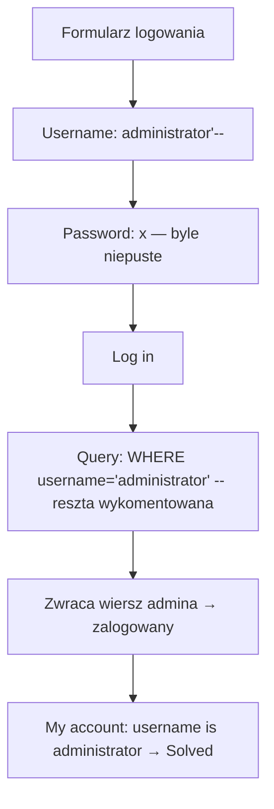

# Lab 02 — SQL injection allowing login bypass

| | |
|---|---|
| **Poziom** | Apprentice |
| **Status** | ✅ rozwiązany |
| **Data** | 2026-11-24 |
| **Narzędzia** | przeglądarka (formularz logowania) |

> 📖 **Teoria tej klasy podatności: [README tematu](README.md).** Tu tylko ten konkretny lab.

---

## Cel

Formularz logowania jest podatny na SQLi. Trzeba zalogować się jako **administrator** bez znajomości hasła.

---

## Trik tego labu

Aplikacja sprawdza dane logowania zapytaniem:
```sql
SELECT * FROM users WHERE username = '<user>' AND password = '<pass>'
```
Logika: **jeśli query zwróci wiersz → login OK**. Przejmujesz kontrolę nad tym, czy wiersz wraca.

**Payload:**
- **Username:** `administrator'--`
- **Password:** cokolwiek niepustego (np. `x`)

Efektywne zapytanie:
```sql
SELECT * FROM users WHERE username = 'administrator'--' AND password = 'x'
                                                   └──── wykomentowane ────┘
```
`'` zamyka string po `administrator`, `--` wycina **całe** sprawdzanie hasła. Backend widzi tylko `WHERE username = 'administrator'` → zwraca wiersz admina → zalogowany. Hasło jest nieistotne, bo leży w martwej, wykomentowanej części.

---

## Przebieg



1. Otwórz formularz logowania.
2. Username = `administrator'--`, Password = dowolny znak.
3. **Log in** → „Your username is: administrator" → **Solved**.

---

## 💥 Moje potknięcia

- **Dwie warstwy walidacji.** Przy pustym password formularz wyrzucił **`Please fill in this field`** — i przez chwilę myślałem, że to mnie blokuje. To była **walidacja front-endowa HTML5** (atrybut `required`), która sprawdza tylko **czy pole jest niepuste**, nie *co* w nim jest. Nie trzeba jej obchodzić — wystarczy wpisać dowolny znak (`x`), który i tak nigdy nie dociera do sprawdzenia hasła (jest wykomentowany). Lekcja: **walidacja po stronie klienta = UX, nie bezpieczeństwo** — potrafi *wyglądać* jak bramka, ale realna bramka jest na backendzie. (Ta sama rodzina co cookie `Admin=false` w access control i `Content-Type` w file upload.)

---

## Czego ten lab dokłada

Ten sam rdzeń co [[01-where-clause-hidden-data]] (`'` + `--`), ale w **innym kontekście**: pole formularza zamiast parametru URL, i inny cel — zamiast rozluźniać filtr, **obchodzisz uwierzytelnianie**. Pokazuje wzorzec „zwraca wiersz = login OK", który SQLi wywraca. Nowy wątek do zapamiętania: **warstwy walidacji** (front-end potrafi udawać przeszkodę, która nią nie jest).
