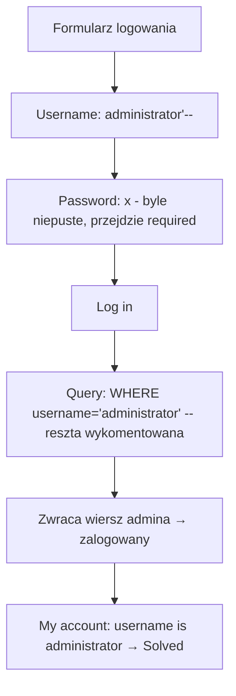

# Lab 02 — SQL injection allowing login bypass

- **Kategoria:** SQL injection (część „Server-side vulnerabilities")
- **Poziom:** Apprentice
- **Data:** 2026-11-24
- **Status:** ✅ rozwiązany
- **Narzędzia:** przeglądarka (formularz logowania)
- **Ścieżka:** lab 2 tematu **SQL injection**, po WHERE clause hidden data

---

## Cel labu

Formularz logowania jest podatny na SQLi. Trzeba zalogować się jako **administrator** bez znajomości hasła.

---

## Koncept: „czy query zwróciło wiersz" = „czy login poprawny"

Aplikacja sprawdza dane logowania zapytaniem:
```sql
SELECT * FROM users WHERE username = '<user>' AND password = '<pass>'
```
Logika: **jeśli query zwróci wiersz → login OK**. Jeśli przejmiesz kontrolę nad tym, czy query zwraca wiersz, obchodzisz logowanie — nie znając hasła.

To ten sam **wytrych `'` + komentarz `--`** co w labie 01, tylko kontekst to pole formularza zamiast parametru URL.

---

## Mechanizm tego labu

- **Username:** `administrator'--`
- **Password:** cokolwiek niepustego (np. `x`)

Query staje się:
```sql
SELECT * FROM users WHERE username = 'administrator'--' AND password = 'x'
                                                   └──── komentarz ────┘
```
- `'` zamyka string po `administrator`,
- `--` wycina **całe** `' AND password = '...'`,
- backend widzi tylko `WHERE username = 'administrator'` → zwraca wiersz admina → zalogowany jako administrator.

Hasło jest nieistotne, bo leży w wykomentowanej, martwej części.

---

## ⭐ Pułapka: dwie warstwy walidacji (front-end vs backend)

Przy pustym password formularz wyrzucił **`Please fill in this field`** — to **walidacja front-endowa HTML5** (atrybut `required`), nie backend. Sprawdza tylko **czy pole jest niepuste**, nie *co* w nim jest.

Nie trzeba jej „obchodzić" — wystarczy **nakarmić** dowolnym znakiem (`x`). Ten znak i tak nigdy nie dotrze do sprawdzenia hasła, bo `--` go wykomentował. Liczy się wyłącznie to, co trafia do backendu.

> **Zasada (powtarza się przez cały kurs):** walidacja po stronie klienta = UX, nie bezpieczeństwo. Łatwo ją ominąć (Burp/DevTools/puste `required`). Ta sama rodzina co cookie `Admin=false` (access control) i `Content-Type` (file upload): **nie ufaj danym/kontroli po stronie klienta.**

---

## Kroki / przepływ ataku



1. Otwórz formularz logowania.
2. Username = `administrator'--`, Password = dowolny znak.
3. **Log in** → „Your username is: administrator" → **Solved**.

---

## Pojęcia do zapamiętania

- **Login bypass (SQLi)** — manipulacja zapytaniem uwierzytelniającym tak, by zwróciło wiersz wybranego usera bez poprawnego hasła.
- **`admin'--`** — kanoniczny payload: zamyka string loginu i komentuje sprawdzenie hasła.
- **Front-end / client-side validation** — walidacja w przeglądarce (HTML5 `required`, JS); to UX, trywialnie omijalna, nigdy nie jest zabezpieczeniem.
- **„Zwraca wiersz = sukces"** — wzorzec logiki auth, który SQLi wywraca, przejmując kontrolę nad warunkiem WHERE.

---

## Mindset

Każdy formularz/parametr, który trafia do zapytania autoryzacyjnego, to kandydat na SQLi login bypass. Pierwszy strzał: `username = administrator'--`, password = byle co. Jeśli nie znasz nazwy usera: `' OR 1=1--` może zalogować jako **pierwszy** wiersz w tabeli (często admin) — ale ostrożnie, bo to zależy od aplikacji.

Rdzeń identyczny jak w 01: **zamknij string (`'`) → ewentualnie dopisz warunek → wykomentuj resztę (`--`)**. Nowy element: świadomość **warstw** — walidacja front-endowa potrafi *wyglądać* jak przeszkoda, ale realna bramka jest na backendzie, a tam decyduje SQL. Dalej w temacie: UNION (wyciąganie danych z innych tabel), blind SQLi.
