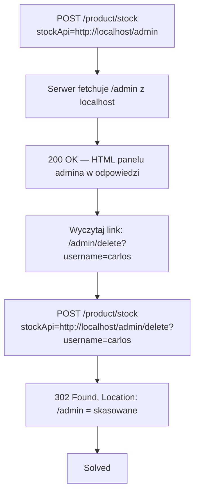

# Lab 01 — Basic SSRF against the local server

- **Kategoria:** SSRF (Server-Side Request Forgery) → atak na sam serwer
- **Poziom:** Apprentice
- **Data:** 2026-10-14
- **Status:** ✅ rozwiązany
- **Narzędzia:** Burp Suite (Repeater) + przeglądarka
- **Ścieżka:** początek tematu **SSRF** (część „Server-side vulnerabilities"), po Authentication

---

## Cel labu

Funkcja „stock check" pobiera dane z wewnętrznego systemu po URL-u podanym w żądaniu. Trzeba **podmienić ten URL na `http://localhost/admin`**, wejść w panel admina i **usunąć użytkownika `carlos`**.

---

## Koncept: SSRF = serwer jako twój posłaniec

Dotąd atakowałeś aplikację **jako klient**: ty wysyłałeś żądanie, serwer ci (nie)ufał. SSRF odwraca kierunek:

> **Zmuszasz serwer, żeby to **on** wysłał żądanie tam, gdzie ty wskażesz.**

Aplikacja ma funkcję, która z założenia sama strzela gdzieś po sieci (pobiera URL, sprawdza stan magazynu w innym systemie, waliduje webhook, ściąga obrazek). Ty podmieniasz **cel** tego żądania — serwer staje się twoim **proxy**.

### Dlaczego to groźne: zaufanie topologiczne (skąd, nie kto)

Tu jest cała esencja i wpięcie w access control, który już znasz:

| | Ty z internetu | Serwer aplikacji |
|---|---|---|
| Dostęp do `localhost` / sieci wewnętrznej | ❌ firewall blokuje | ✅ jest **wewnątrz** |
| Jak widzi go `/admin` | obcy, nieautoryzowany | „swój", z zaufanego miejsca |

Wiele systemów ufa **nie temu *kto* pyta, tylko *skąd* przychodzi żądanie**. Panel admina często zakłada: „skoro request leci z `127.0.0.1` / sieci lokalnej, to musi być ktoś zaufany" (admin odzyskujący dostęp po utracie haseł, inny mikroserwis za firewallem). To **access control oparty na lokalizacji sieciowej zamiast na tożsamości** — i dokładnie to łamiesz: twoje żądanie „przebiera się" za lokalne, bo fizycznie wychodzi z serwera.

Powody, dla których serwery tak ufają lokalnym żądaniom (z materiału):
- **check uprawnień siedzi w komponencie *przed* aplikacją** (reverse proxy / gateway) — połączenie zwrotne z serwera do siebie omija ten front.
- **tryb disaster-recovery** — dostęp admina bez logowania „jeśli przychodzisz z local machine".
- **panel admina na innym porcie**, nieosiągalnym bezpośrednio z zewnątrz.

---

## Mechanizm tego labu

Podatny punkt: parametr `stockApi` w `POST /product/stock` zawiera **pełny URL**, do którego backend sam strzela:

```
stockApi=http://stock.weliketoshop.net:8080/product/stock/check?productId=...
```

Cel żądania pochodzi z inputu → podmieniasz go na adres lokalny:

```
stockApi=http://localhost/admin
```

Serwer pobiera `/admin` **z własnej perspektywy** → access control przepuszcza (bo „żądanie lokalne") → oddaje HTML panelu w **odpowiedzi na stock check**. Z panelu wyczytujesz link `Delete` i strzelasz tym samym kanałem.

> Ten lab to w praktyce **SSRF jako wytrych do broken access control**: panel `/admin` sam w sobie jest chroniony, ale ufa „lokalnemu" pochodzeniu — a SSRF to pochodzenie fałszuje.

---

## Kroki / przepływ ataku



1. Przechwyć `POST /product/stock` (stock check) → **Send to Repeater**.
2. Podmień wartość na `stockApi=http://localhost/admin`.
   - Odpowiedź: **200 OK, ~3174 B**, w body cały HTML panelu admina z listą `wiener` / `carlos`.
3. W HTML-u znajdź link kasowania: `<a href="/admin/delete?username=carlos">Delete</a>`.
4. Podmień parametr na `stockApi=http://localhost/admin/delete?username=carlos`.
   - Odpowiedź: **302 Found, Location: /admin** = akcja wykonana.
5. **Solved.**

---

## ⭐ Niuans: ścieżkę `/admin` czyta się z odpowiedzi stock-checka

SSRF tutaj jest **„in-band" (returned)** — serwer **odsyła ci treść** pobranego URL-a w swojej odpowiedzi. Dlatego od razu widzisz HTML panelu i możesz wyczytać link `Delete`. (W cięższych labkach SSRF bywa **blind** — serwer strzela, ale nic ci nie zwraca; wtedy trzeba np. Burp Collaboratora.)

Druga rzecz: **delete poszedł GET-em** (`/admin/delete?username=...` to `<a href>`), a opakowany jest w `POST /product/stock`. Backend fetchuje podany URL swoją własną metodą GET — ta sama „strona ≠ akcja" co w access control: wystarczyło znać URL akcji.

---

## Pułapki

- **URL-encoding wartości** — tu zadziałał goły `http://localhost/admin`, ale często wartość `stockApi` bywa URL-encoded (np. `%3F` zamiast `?`). Jak nie działa od pierwszego strzału — sprawdź, czy znaki specjalne (`?`, `&`, `:`) nie wymagają zakodowania. (W tym labie **nie było** trzeba.)
- **Mylenie `localhost` z własną maszyną** — `localhost`/`127.0.0.1` w tym URL-u znaczy **serwer aplikacji**, nie twój komputer. To w tym cała sól.
- **Blind vs returned** — tu dostałeś treść w odpowiedzi; nie zakładaj, że tak jest zawsze.

---

## Pojęcia do zapamiętania

- **SSRF (Server-Side Request Forgery)** — zmuszenie serwera do wysłania żądania do celu wskazanego przez atakującego.
- **Loopback / `localhost` / `127.0.0.1`** — adres „do samego siebie"; z zewnątrz nieosiągalny, z serwera tak.
- **Zaufanie topologiczne** — ufanie żądaniu po jego *pochodzeniu* (lokalne) zamiast po *tożsamości*; fundament, który SSRF łamie.
- **In-band / returned SSRF** — serwer odsyła treść pobranego URL-a (widzisz wynik). Przeciwieństwo: **blind SSRF**.

---

## Mindset

Sygnał „to może być SSRF": aplikacja przyjmuje **URL / host / adres** jako input i coś z nim robi po stronie serwera (`stockApi=`, `url=`, `feed=`, `callback=`, `webhook=`, `dest=`, ładowanie obrazka po URL).

Powtarzalny schemat SSRF (atak na serwer): **znajdź parametr z URL-em → wskaż nim adres wewnętrzny (`localhost`, `127.0.0.1`, inny port, usługa za firewallem) → serwer sięga tam jako „zaufany" → czytasz odpowiedź**. Kolejne labki będą utrudniać: cel inny niż `localhost` (sieć wewnętrzna), **filtry/blacklisty** na `localhost` do obejścia (alternatywne zapisy IP, redirecty, `##`), oraz **blind SSRF** (Collaborator).
