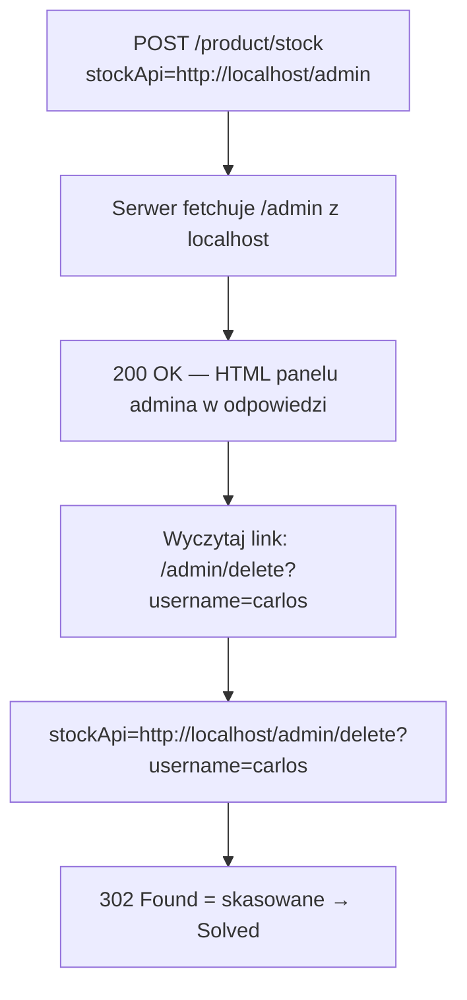

# Lab 01 — Basic SSRF against the local server

| | |
|---|---|
| **Poziom** | Apprentice |
| **Status** | ✅ rozwiązany |
| **Data** | 2026-10-14 |
| **Narzędzia** | Burp (Repeater) + przeglądarka |

> 📖 **Teoria tej klasy podatności: [README tematu](README.md).** Tu tylko ten konkretny lab.

---

## Cel

Funkcja „stock check" pobiera dane z wewnętrznego systemu po URL-u z żądania. Podmienić ten URL na `http://localhost/admin`, wejść w panel admina i usunąć `carlos`.

---

## Trik tego labu

Parametr `stockApi` w `POST /product/stock` zawiera **pełny URL**, do którego backend sam strzela:
```
stockApi=http://stock.weliketoshop.net:8080/product/stock/check?productId=...
```
Cel pochodzi z inputu → podmieniasz go na adres lokalny:
```
stockApi=http://localhost/admin
```
Serwer pobiera `/admin` **z własnej perspektywy** → access control przepuszcza (bo „żądanie lokalne") → oddaje HTML panelu w **odpowiedzi na stock check** (SSRF **in-band / returned**). Z panelu czytasz link `Delete` i strzelasz tym samym kanałem.

> Ten lab to **SSRF jako wytrych do broken access control**: panel `/admin` jest chroniony, ale ufa „lokalnemu" pochodzeniu, a SSRF to pochodzenie fałszuje. `localhost` = serwer aplikacji, nie twój komputer.

---

## Przebieg



1. Przechwyć `POST /product/stock` → **Send to Repeater**.
2. `stockApi=http://localhost/admin` → odpowiedź 200, w body HTML panelu z `wiener`/`carlos`.
3. W HTML znajdź `<a href="/admin/delete?username=carlos">`.
4. `stockApi=http://localhost/admin/delete?username=carlos` → 302 Found = akcja wykonana → **Solved**.

---

## 💥 Moje potknięcia

- Brak realnych wpadek (tu goły URL zadziałał od razu), ale zapisane na przyszłość: wartość `stockApi` bywa **URL-encoded** (np. `%3F` zamiast `?`) — jak nie działa od pierwszego strzału, sprawdź, czy znaki specjalne (`?`, `&`, `:`) nie wymagają zakodowania. Łatwo też pomylić `localhost` z własną maszyną — to **serwer aplikacji**.

---

## Czego ten lab dokłada

Wprowadza rdzeń SSRF (**returned/in-band** — treść wraca w odpowiedzi) i pokazuje go jako wytrych do broken access control. Niuans: delete poszedł **GET-em** (`<a href>`) opakowanym w `POST /product/stock` — backend fetchuje URL swoją metodą; to ta sama „strona ≠ akcja" co w access control. Następny [[02-basic-ssrf-another-backend]] przenosi cel z `localhost` do nieznanego adresu w LAN (skan).
