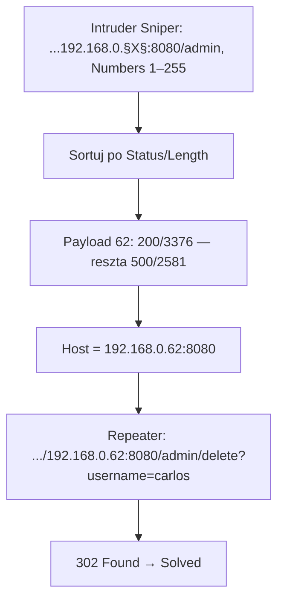

# Lab 02 — Basic SSRF against another back-end system

| | |
|---|---|
| **Poziom** | Apprentice |
| **Status** | ✅ rozwiązany |
| **Data** | 2026-10-14 |
| **Narzędzia** | Burp (Intruder + Repeater) |

> 📖 **Teoria tej klasy podatności: [README tematu](README.md).** Tu tylko ten konkretny lab.

---

## Cel

„Stock check" dociera do systemów w podsieci `192.168.0.0/24`. Wyskanować zakres w poszukiwaniu panelu admina na porcie **8080**, potem usunąć `carlos`.

---

## Trik tego labu

Cel jest na **innej maszynie w LAN** (z internetu nieosiągalnej), a **nie znasz adresu**. Używasz SSRF jako **skanera sieci**: wystrzeliwujesz wszystkie 256 adresów i szukasz **odstającego**.

**Setup Intrudera (Sniper):** § tylko na ostatnim oktecie:
```
stockApi=http://192.168.0.§§:8080/admin
```
Payload: **Numbers 1–255**. Odczyt — sortuj po **Status / Length**:

| Payload | Status | Length | Znaczenie |
|---|---|---|---|
| 2,3,4,5… | 500 | 2581 | **martwy adres** (connection error) |
| **62** | **200** | **3376** | ⭐ **żywy host** — panel admina |

> Martwe adresy dają **stały, powtarzalny** Status/Length. Żywy host **odstaje**. Ta sama logika „szukaj sieroty w kolumnie Length" co przy [[01-username-enumeration-different-responses]].

Znaleziono: `192.168.0.62:8080`.

---

## Przebieg



1. Intruder Sniper na ostatnim oktecie, Numbers 1–255, cel `/admin`.
2. Sortuj → payload **62** = 200/3376 (reszta martwa).
3. Repeater: `stockApi=http://192.168.0.62:8080/admin/delete?username=carlos`.
4. 302 Found = skasowany → **Solved**.

---

## 💥 Moje potknięcia

- **Literówka `stockApi` vs `stockapi`** — nazwa parametru jest case-sensitive; zły zapis = serwer nie rozpoznaje parametru. Na tym się realnie potknąłem.
- Przypomnienie o URL-encodingu wartości `stockApi` (oryginał był cały zakodowany) — tu znaki w IP/porcie były bezpieczne, ale przy złożonych ścieżkach `?`/`&`/`:` bywają winowajcą „czemu nie działa".

---

## Czego ten lab dokłada

Rozszerza SSRF o **skanowanie sieci wewnętrznej** (gdy nie znasz adresu celu). Nowe koncepty: prywatne/nie-routowalne IP, „protected by network topology" = słaby security posture, port scanning przez SSRF. Mechanika **„szukaj odstającego wiersza"** w Intruderze — wspólna z username enumeration, tylko domeną jest teraz przestrzeń adresów IP. Dalej: obejścia filtrów `localhost` i **blind SSRF** (Collaborator).
