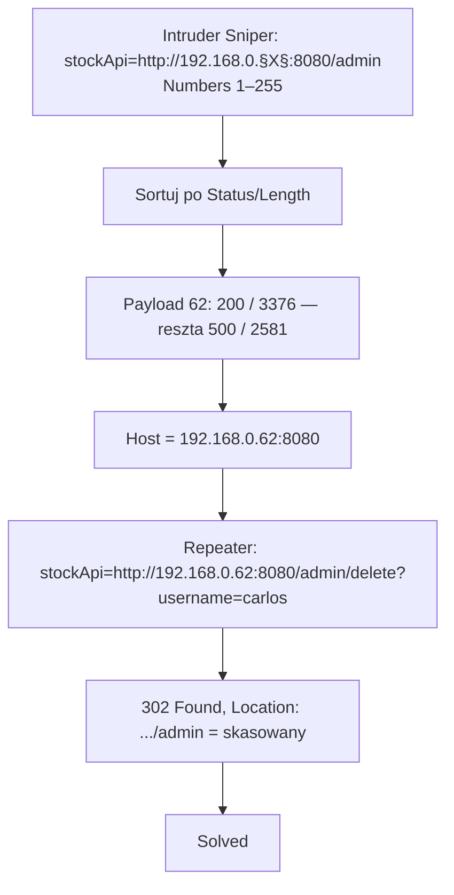

# Lab 02 — Basic SSRF against another back-end system

- **Kategoria:** SSRF → atak na inny system back-end (sieć wewnętrzna)
- **Poziom:** Apprentice
- **Data:** 2026-10-14
- **Status:** ✅ rozwiązany
- **Narzędzia:** Burp Suite (Intruder + Repeater)
- **Ścieżka:** druga labka tematu **SSRF**, po [[01-basic-ssrf-local-server]]

---

## Cel labu

Funkcja „stock check" dociera do systemów w wewnętrznej podsieci `192.168.0.0/24`. Trzeba **wyskanować ten zakres** w poszukiwaniu panelu admina na porcie **8080**, a potem **usunąć `carlos`**.

---

## Koncept: SSRF jako skaner sieci wewnętrznej

W [[01-basic-ssrf-local-server]] cel był na samym serwerze (`localhost`). Tu cel jest **na innej maszynie w LAN** — z internetu nieosiągalnej (prywatny, nie-routowalny IP), ale serwer aplikacji ją widzi.

| | Lab 01 | Lab 02 |
|---|---|---|
| Cel | `localhost` (ten sam serwer) | `192.168.0.X:8080` (inna maszyna w LAN) |
| Znasz adres? | tak | **nie — musisz go znaleźć** |
| Technika | jeden strzał | **skan zakresu (Intruder)** |

Nowa supermoc SSRF:

> Skoro serwer strzela tam, gdzie wskażesz, możesz go użyć jako **skanera portów/hostów sieci wewnętrznej**. Przebiegasz po zakresie adresów i patrzysz, **który odpowiada inaczej** → tam coś żyje.

Dlaczego te systemy są łatwym łupem (z materiału): back-endy „chronione topologią sieci" (zakłada się, że nikt z zewnątrz tam nie dojdzie) mają często **słabszy security posture** — wrażliwe funkcje **bez żadnej autentykacji**, dostępne dla każdego, kto potrafi do nich zagadać. SSRF daje Ci dokładnie tę możliwość.

---

## Mechanizm: enumeracja ostatniego oktetu Intruderem

Nie wiesz, który z 256 adresów (`.1`–`.255`) hostuje panel. Wystrzeliwujesz **wszystkie** i szukasz odstającego.

**Setup Intrudera (Sniper):**
1. `POST /product/stock` → Send to Intruder.
2. Pozycja `§` **tylko na ostatnim oktecie**:
   ```
   stockApi=http://192.168.0.§§:8080/admin
   ```
3. Attack type: **Sniper**.
4. Payloads → typ **Numbers**, from **1**, to **255**, step **1** (255 żądań).
5. Start attack.

**Odczyt wyników — sortuj po `Status code` / `Length`:**

| Payload | Status | Length | Znaczenie |
|---|---|---|---|
| 1 | 400 | 141 | artefakt (brzydki request) |
| 2,3,4,5… | 500 | 2581 | **martwy adres** — nikt nie nasłuchuje / connection error |
| **62** | **200** | **3376** | ⭐ **żywy host** — panel admina |

> Martwe adresy dają **stały, powtarzalny** Status/Length (tu 500 / 2581). Żywy host **odstaje** — inny status (200) i inna długość. To ta sama logika „szukaj sieroty w kolumnie Length", co przy username enumeration w Authentication.

**Znaleziono: `192.168.0.62:8080`.**

---

## Kroki / przepływ ataku



1. Intruder Sniper na ostatnim oktecie, Numbers 1–255, cel `/admin`.
2. Sortuj wyniki → payload **62** = 200/3376 (reszta martwa).
3. W Repeaterze wołasz na znalezionym IP endpoint kasowania:
   `stockApi=http://192.168.0.62:8080/admin/delete?username=carlos`
4. **302 Found**, `Location: http://192.168.0.62:8080/admin` = akcja wykonana.
5. **Solved.**

---

## Pułapki

- **URL-encoding wartości `stockApi`** — oryginalny request miał całość zakodowaną (`http%3A%2F%2F192.168.0.1%3A8080%2F...`). W Intruderze wstawiłem czytelny URL (`http://192.168.0.§§:8080/admin`); zadziałał bez ręcznego kodowania, bo tu znaki w samym IP/porcie są bezpieczne. Przy bardziej złożonych ścieżkach pamiętaj, że `?`, `&`, `:` mogą wymagać encodingu — to nawykowy winowajca „czemu nie działa".
- **Literówka `stockApi` vs `stockapi`** — nazwa parametru jest case-sensitive; zły zapis = serwer nie rozpoznaje parametru. (Realnie się na tym potknąłem i poprawiłem.)
- **Community dławi ~1 req/s** — skan 255 adresów to ~4 min. To nie zawieszenie.
- **Celowanie od razu w `/admin`** — zadziałało (żywy host zwrócił 200 z panelem). Alternatywnie można skanować samo `:8080/` i dostrzelić `/admin` na trafionym IP — czytelniejszy podział, ale więcej kroków.

---

## Pojęcia do zapamiętania

- **Prywatny / nie-routowalny IP** — zakresy `10.0.0.0/8`, `172.16.0.0/12`, `192.168.0.0/16`; nieosiągalne z publicznego internetu, tylko z wnętrza sieci.
- **Port scanning przez SSRF** — użycie podatnego serwera jako proxy do mapowania żywych hostów/portów sieci wewnętrznej (status/length jako sygnał).
- **„Protected by network topology"** — jedyną ochroną back-endu jest to, że „nikt z zewnątrz nie dojdzie"; SSRF to obala → słaby security posture staje się dostępny.
- **Sniper (Intruder)** — jeden punkt wstrzyknięcia, jedna lista payloadów; idealne do przelecenia zakresu liczb.

---

## Mindset

Rozszerzenie schematu z [[01-basic-ssrf-local-server]]: gdy nie znasz adresu celu, **SSRF + Intruder = skaner sieci wewnętrznej**. Wzorzec: **parametr z URL-em → sparametryzuj oktet/port → Numbers 1–255 → sortuj po Status/Length → sierota = żywy host → dostrzel endpoint akcji**.

To dokładnie ta sama „szukaj odstającego wiersza" mechanika co przy username enumeration — tylko domeną jest teraz przestrzeń adresów IP, nie lista loginów. Następne w temacie: **obejścia filtrów** blokujących `localhost`/prywatne IP oraz **blind SSRF** (Collaborator).
