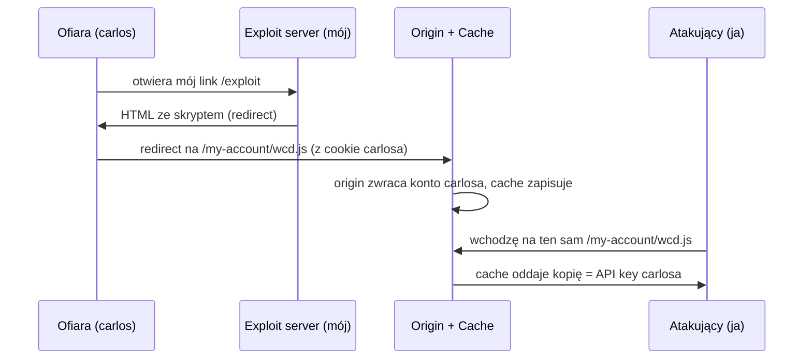

# Lab 01 — Exploiting path mapping for web cache deception

| | |
|---|---|
| **Poziom** | Apprentice |
| **Status** | ✅ rozwiązany |
| **Data** | 2026-08-23 |
| **Narzędzia** | Burp Community (Proxy + Repeater), exploit server |

> 📖 **Teoria tej klasy podatności: [README tematu](README.md).** Tu tylko ten konkretny lab.

---

## Cel

Wykraść **API key użytkownika carlos**, mając dostęp tylko do własnego konta (`wiener:peter`).

---

## Trik tego labu

Origin używa **dopasowania po prefiksie**: endpoint to `/my-account`, a wszystko doklejone dalej (`/my-account/cokolwiek`) trafia do tej samej logiki i zwraca konto. Sufiks jest **ignorowany przez origin**, ale **widziany przez cache**.

Payload: **`/my-account/wcd.js`**
- origin: prefiks pasuje do `/my-account` → oddaje konto z API key,
- cache: kończy się `.js` → static extension → zapisuje.

---

## Przebieg

**Rekon (Repeater):**
1. Login `wiener:peter`, znajdź API key na `/my-account`.
2. `GET /my-account/aaa` → dalej wraca konto = origin ignoruje sufiks ✅ (path mapping).
3. `GET /my-account/aaa.js` → wraca konto + `X-Cache: miss`; wyślij 2× → `hit` = cache zapisuje ✅.

**Exploit (delivery jak w [README](README.md)):** skrypt z `document.location=".../my-account/wcd.js"` → Store → Deliver → szybko Repeater `GET /my-account/wcd.js` → `hit` + klucz carlosa → Submit.

---

## 💥 Moje potknięcia

- **Cache żyje ~30 s** (`max-age=30`) — za pierwszym razem czekałem za długo, wpis wygasł (`miss`). Deliver → **od razu** Repeater.
- **Nie wchodź sam na payload przed carlosem** — zacachujesz SWOJE konto (leci twój cookie). Jak się stanie: świeża nazwa (`wcd2.js`).
- **Store przed Deliver** — bez Store bot dostanie starą wersję skryptu.
- **Nazwa pliku musi się zgadzać** w skrypcie i w Repeaterze (cache trzyma kopię pod konkretnym URL-em).

---

## Czego ten lab dokłada

Najprostsza rozbieżność (**path mapping** — ignorowany sufiks) i cały szkielet dostarczenia (exploit server, cookie ofiary, czytanie `X-Cache`). Fundament pod resztę tematu — w [[02-path-delimiters]] zmienia się tylko *mechanizm rozbieżności* (delimiter zamiast prefiksu), reszta identyczna.
